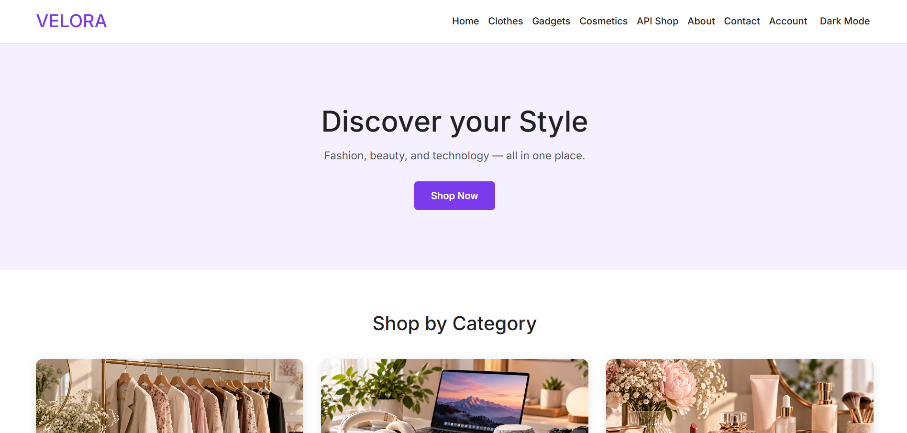
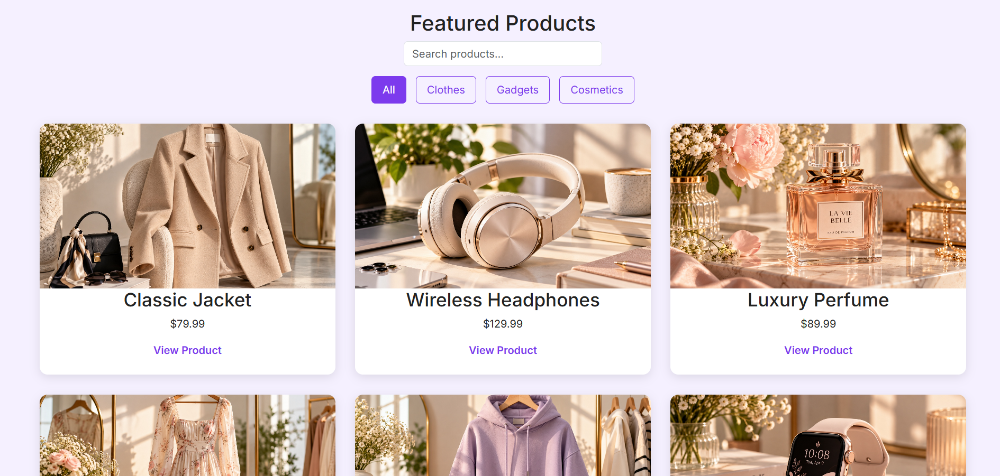
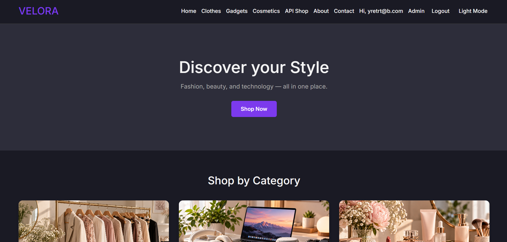
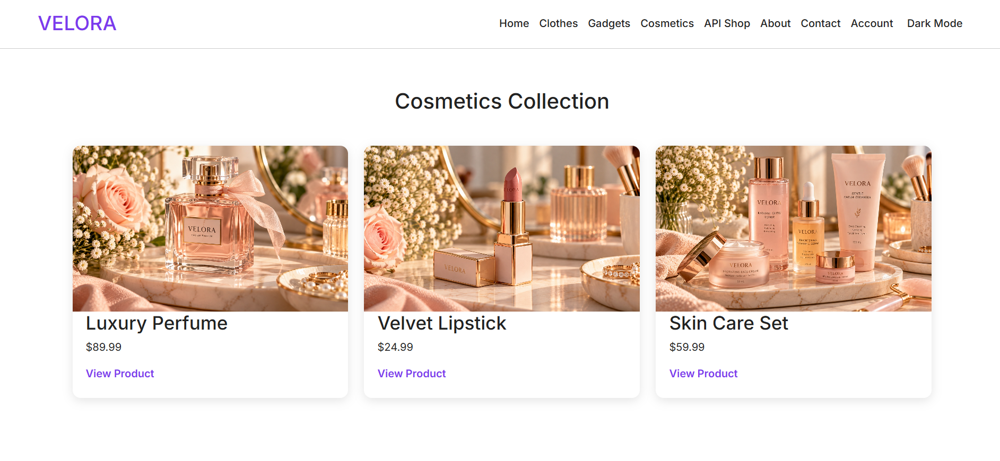
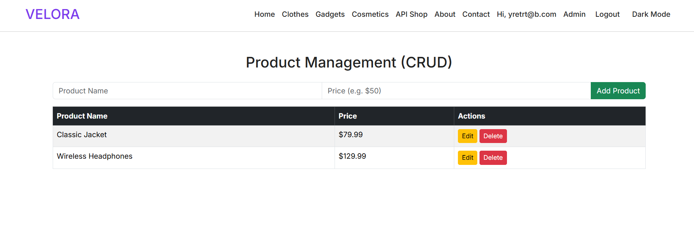
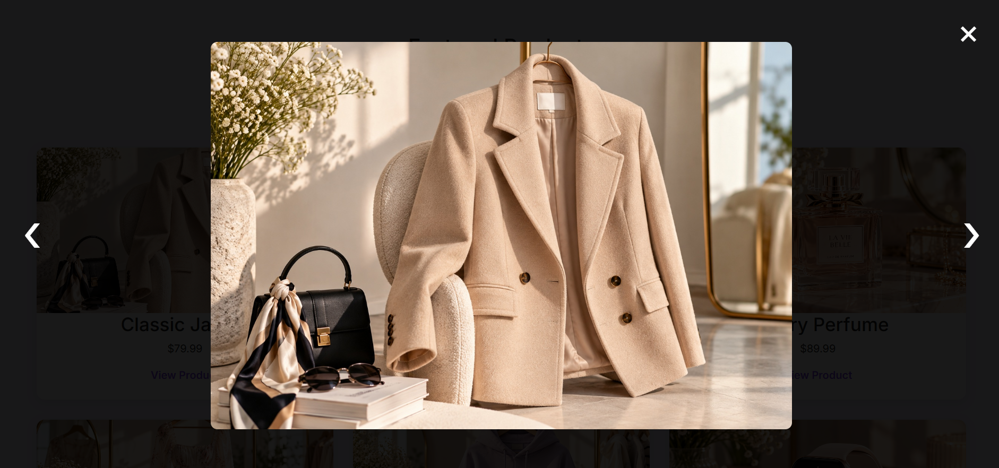
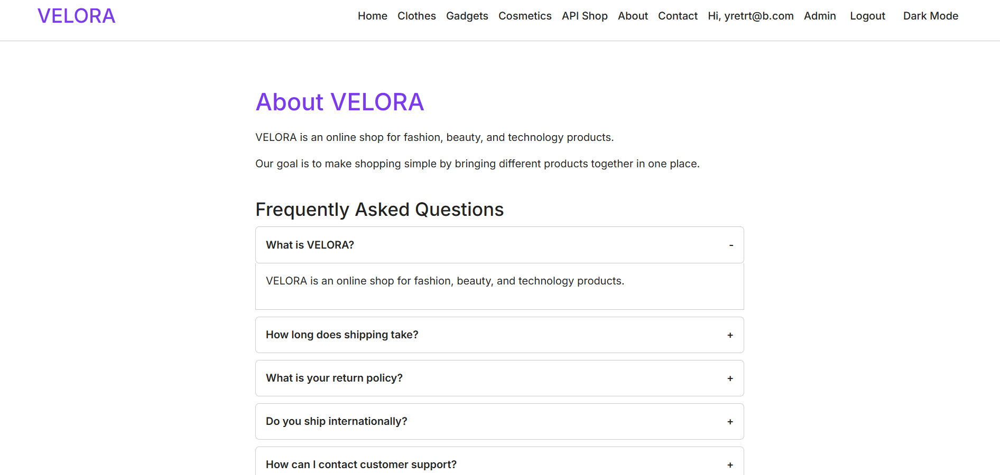
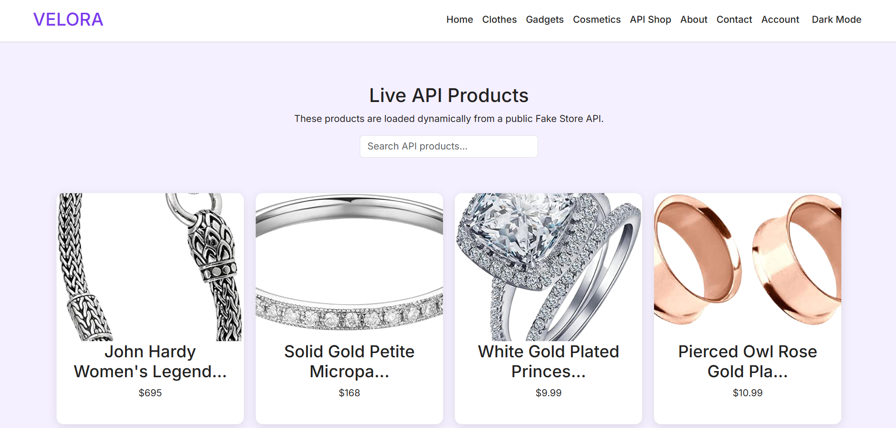

# VELORA Online Shop

**Live site:** https://nargess377.github.io/online-shop
**Presentation** https://docs.google.com/presentation/d/1d5a2gnuqCyqR2kR8gf6PFVHbecJ08AOvcVwoAIwt8VE/edit?usp=sharing

## What this is

VELORA is a multi-page online shop we built for our Web Technologies course. It sells clothes, gadgets and cosmetics all in one place, and we added the dynamic features on top of a normal static site. Dark mode, login, an FAQ, an admin table and a page that loads real products from a public API.

## Group members (IT-2513)

- Narges Jowkar
- Zhanbolat Tulepbergen
- Avirup Roy

## Pages and layout

There are 9 pages: `index.html`, `clothes.html`, `gadgets.html`, `cosmetics.html`, `api.html`, `about.html`, `contact.html`, `account.html`, `admin.html`. Every page has the same nav bar and footer, and we used one stylesheet (`css/style.css`) so the design stays consistent.

We used Flexbox for the header/nav and product cards, CSS Grid for the category and product grids, and the Bootstrap grid on the product pages. Media queries at 900px and 600px handle tablet and mobile. Colors are defined once in `:root` as CSS variables, which is how the dark mode toggle works across the whole site without touching every rule.

## Features we implemented

**JavaScript**
- **Theme toggle:** saved in `localStorage`, so it stays dark or light after a refresh and on every page.
- **Sign-in:** the form asks for an email and a password. We check the email against a regex (also using `type="email"` for browser validation) and require a password of at least 4 characters. Once signed in, the navbar shows the email, the Admin link appears, and a Logout button clears the session. The state survives a refresh because it's stored in `localStorage`.
- **Registration:** email regex, password-match check, and a password strength indicator. We changed the strength logic to count how many character types are used (letters, digits, special) instead of just length, so something like `1111111111` now correctly shows as Weak.
- **Lightbox:** clicking any product image on the home page opens it in a fade-in overlay with prev/next arrows.

**jQuery**
- **FAQ accordion** on the About page: 5 questions, opens/closes with `.slideToggle()`, and the `+` / `−` flips when expanded.
- **Search and category filter** on the home page: filters the product grid live as you type or click a button.
- **Admin CRUD table**: add new products, edit them via prompt, and delete with a confirmation.
- **Password strength indicator**: updates as you type using a jQuery `keyup` handler.

**API**
- The `api.html` page pulls women's clothing and jewelry products from the Fake Store API using `fetch()`. There's a search box on top that filters the loaded cards live, and a `.catch()` block that shows an error message if the request fails.

## Tech Stack

HTML5, CSS3 (Flexbox, Grid, custom properties, media queries), Bootstrap 5, JavaScript (ES6, fetch, localStorage), jQuery 3.7, Google Fonts (Inter). Hosted on GitHub Pages.

## Contributions

We split the work by page and by feature, but everyone reviewed and tested everyone else's code before the final commit. Here's roughly what each person owned.

**Narges Jowkar**
- Home, Clothes, and Contact pages
- The header and navigation
- Flexbox layouts, hover/focus effects, responsive breakpoints
- Registration form (email regex, password strength indicator)
- The Account page that combines login and registration into one file
- Sign-in logic with `localStorage`, the navbar update after login, and the logout button

**Zhanbolat Tulepbergen**
- Gadgets, Cosmetics, and About pages
- The footer
- CSS Grid and the Bootstrap grid on product pages
- The product comparison table on Gadgets
- CSS positioning for the lightbox arrows and close button, plus `:nth-child()` somewhere in the category styling
- Lightbox gallery with fade transitions and prev/next navigation
- Home page search and category filter
- FAQ accordion on the About page

**Avirup Roy**
- Contact form structure and its validation attributes
- Fixed broken nav links and did a full pass on cross-page paths
- CSS variables in `:root` and applying them consistently
- Bootstrap utility classes across pages
- `loading="lazy"` on below-the-fold images
- Admin CRUD page
- Dark/light theme toggle
- API page with `fetch()`, live search, and error handling

At the very end we did a shared pass fixing small bugs, the confirm-password message used to stay green when you changed a matching password to a non-matching one (the CSS classes weren't being cleaned up), the strength indicator only used length, and the admin page was missing a footer. Those were the main loose ends before the final commit.

## AI usage

We used AI tools as supporting help, mainly for reviewing code we'd already written, spotting bugs we missed, and proofreading this README. For example, AI helped us find the confirm-password class bug and suggested switching the strength indicator to count character types instead of length only. We did not copy-paste code without reading it.

## Screenshots

### Home Page (with Search & Filter; Light and Dark Mode)

### Clothes Page

### Gadgets Page

### Cosmetics Page

### Account Page (Sign-in + Registration)

### Admin CRUD Table

### Lightbox Gallery

### About & FAQ Section

### API Integration
