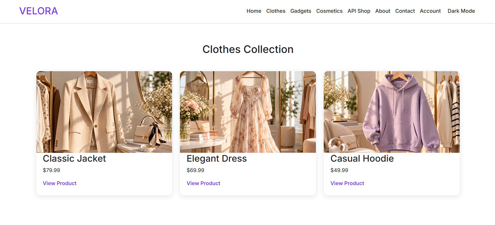
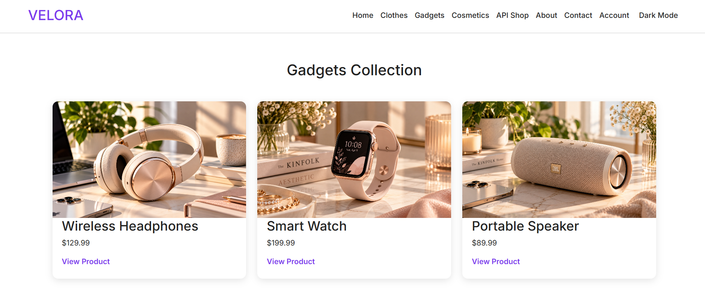
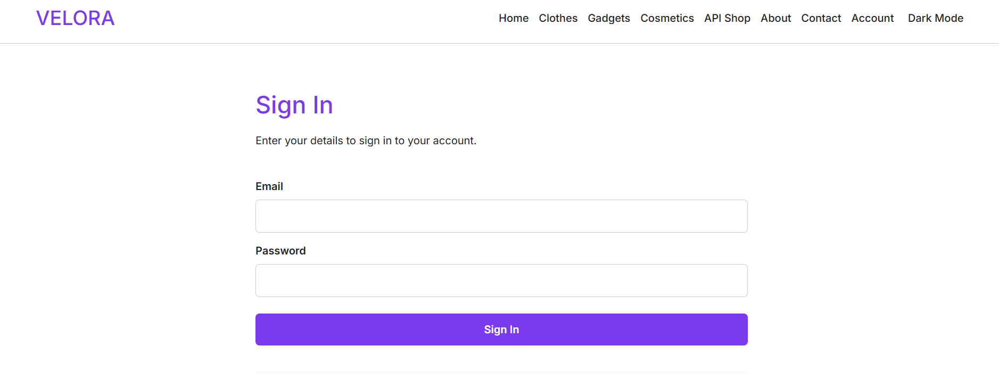
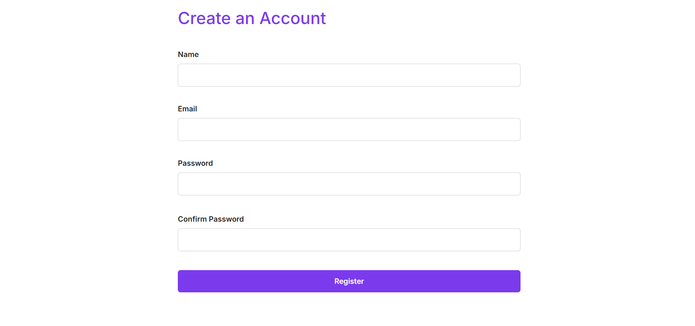
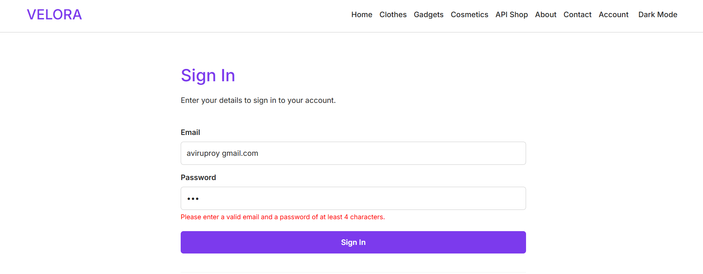
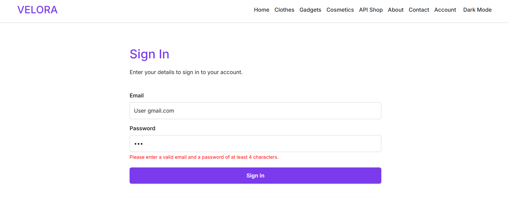
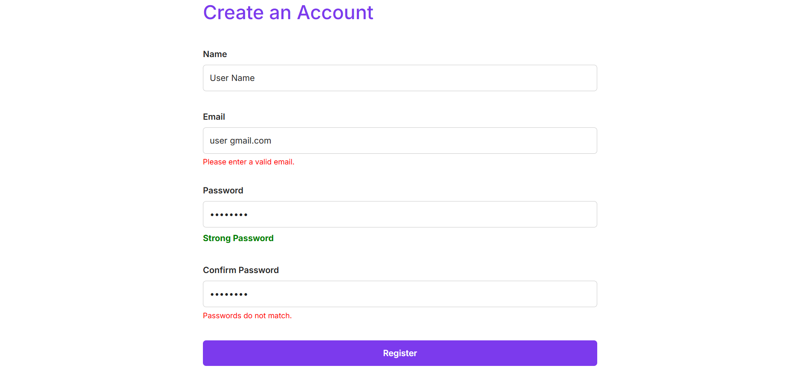

# VELORA Online Shop

## Published Website
[VELORA Online Shop](https://nargess377.github.io/online-shop/)

## GitHub Repository
[VELORA GitHub Repo](https://github.com/nargess377/online-shop)

## Project Topic

VELORA is a responsive multi-page online shopping website for fashion, beauty, and technology products, enhanced with dynamic interactivity, persistent themes, user authentication, and live API integration.

## Group Members

- IT-2513 Narges Jowkar
- IT-2513 Zhanbolat Tulepbergen
- IT-2513 Avirup Roy

## Project Description

VELORA is an online shop designed to provide different types of products in one website. The website contains separate collections for clothes, gadgets, and cosmetics. It was created using HTML, CSS, Bootstrap, JavaScript, and jQuery, and features:

- Dynamic product search and category filtering
- An interactive image lightbox gallery
- An admin CRUD table for product management
- A persistent dark/light theme toggle
- A `localStorage`-based sign-in system with email validation
- A registration form with character-type-aware password strength feedback
- An FAQ accordion
- Live data fetched from an external public API

The project is organised into 9 connected pages (`index.html`, `clothes.html`, `gadgets.html`, `cosmetics.html`, `api.html`, `about.html`, `contact.html`, `account.html`, `admin.html`), all sharing a consistent navigation bar, design language, and footer.

## Features Implemented

### Midterm Features
- Nine connected web pages sharing one navigation bar
- Responsive header and footer
- Clothes, gadgets, and cosmetics product collections
- Product cards with images, names, and prices
- Featured products section on the home page
- Product comparison table on the Gadgets page
- Contact form
- Flexbox layouts (header/nav, category and product grids)
- CSS Grid layouts (`category-grid`, `product-grid`, `api-grid`)
- Bootstrap responsive grid (`row`/`col-*` classes on product pages)
- Bootstrap utility classes (`mb-*`, `text-center`, `container`, `table-*`, etc.)
- Responsive design using media queries (breakpoints at 900px and 600px)
- Hover and focus effects on nav links, cards, and buttons
- CSS `:nth-child()` pseudo-class
- CSS custom properties (`:root` variables) for the colour system
- CSS positioning (absolute arrows and close button in the lightbox)
- Google Fonts (Inter)
- Lazy loading for below-the-fold product images

### Endterm Features
- **Form Validation (Registration):** real-time password strength indicator, email RegEx validation, password matching, and inline error messages.
- **Dynamic Search & Filter:** search bar and category buttons that filter the featured products instantly without reloading.
- **CRUD Operations (Admin):** an admin page where products can be Created, Read, Updated, and Deleted dynamically via jQuery.
- **Image Lightbox Gallery:** clicking a product image opens a lightbox with fade-in/fade-out transitions and next/previous navigation.

### Final Project Features
- **Light/Dark Theme Toggle:** persistent theme selection saved in `localStorage` and applied consistently across every page.
- **Sign-in Functionality:** login state saved in `localStorage`, the navbar updates dynamically with a welcome message, the Admin link is hidden until login, and a Logout button clears the session.
- **Enhanced Sign-in Validation:** the sign-in form validates email format (via a shared `emailRegex`) and enforces a minimum password length, while deliberately *not* applying strength rules to login (to avoid locking out valid legacy passwords).
- **Character-Type-Aware Password Strength:** the registration strength indicator counts how many character types are present (letters / digits / special characters) in addition to length, so numeric-only strings such as `1111111111` are correctly shown as **Weak** rather than falsely labelled Strong.
- **FAQ Section:** interactive accordion on the About page using jQuery `.slideToggle()` with `+` / `−` indicators.
- **Public API Integration:** uses `fetch()` to pull live women's clothing and jewelry products from the Fake Store API, rendered dynamically with a live search filter and error handling.

## Technologies Used

- HTML5 (semantic structure)
- CSS3 (Flexbox, Grid, custom properties, media queries)
- Bootstrap 5
- JavaScript (ES6, `fetch`, `localStorage`, RegEx)
- jQuery 3.7
- Google Fonts (Inter)
- GitHub Pages (deployment)

## Individual Contributions

### Midterm Contributions

**Student 1 — Narges Jowkar**
- Developed the Home page
- Developed the Clothes page
- Developed the Contact page
- Created the main header and navigation
- Implemented Flexbox
- Implemented hover and focus effects
- Worked on responsive design

**Student 2 — Zhanbolat Tulepbergen**
- Developed the Gadgets page
- Developed the Cosmetics page
- Developed the About page
- Created the footer
- Implemented CSS Grid
- Implemented the Bootstrap grid
- Created the product comparison table
- Implemented CSS positioning and `:nth-child()`
- Worked on responsive design

**Student 3 — Avirup Roy**
- Developed the Contact form structure and validation attributes
- Tested all navigation links and fixed broken paths between pages
- Performed final code cleanup and cross-browser testing
- Implemented CSS variables in `:root` and applied them consistently across the stylesheet
- Applied Bootstrap utility classes and ensured Bootstrap was linked on all pages
- Added `loading="lazy"` to below-the-fold images for performance

### Endterm Contributions

**Student 1 — Narges Jowkar**
- Developed the registration form (now part of `account.html`)
- Implemented real-time email RegEx validation
- Implemented the password strength indicator (Weak/Medium/Strong) using jQuery events

**Student 2 — Zhanbolat Tulepbergen**
- Implemented the dynamic Search Bar and Category Filter logic on the Home page
- Developed the Lightbox Image Gallery
- Added jQuery `.fadeIn()` / `.fadeOut()` transitions and navigation arrows for the lightbox

**Student 3 — Avirup Roy**
- Developed the Admin CRUD Table page (`admin.html`)
- Implemented Create (Add) and Read (Display) functionality using jQuery `.append()`
- Implemented Update (Edit via prompt) and Delete (with confirmation)
- Maintained the `/js/script.js` file structure and ensured all jQuery code runs inside `$(document).ready()`

### Final Project Contributions

**Student 1 — Narges Jowkar**
- Developed the merged Account page (`account.html`) containing both the registration form and the sign-in form
- Implemented the `localStorage` login logic to keep users signed in after page refresh
- Dynamically updated the navigation bar to display the user's email and a Logout button when authenticated
- Implemented the sign-out functionality to clear the `localStorage` session
- Enhanced sign-in validation to check email format (shared `emailRegex`) and password length

**Student 2 — Zhanbolat Tulepbergen**
- Merged the FAQ section into the About page (`about.html`) with 5 project-specific questions
- Implemented the jQuery `.slideToggle()` accordion effect for the answers
- Added dynamic visual indicators (`+` / `−`) to show expanded/collapsed states

**Student 3 — Avirup Roy**
- Implemented the Light/Dark theme toggle using jQuery and saved the preference in `localStorage` so it persists across page refreshes
- Created the API integration page (`api.html`)
- Used JavaScript `fetch()` to retrieve JSON from the Fake Store API and dynamically render it to the DOM
- Added a real-time search filter for API products and implemented error handling via `.catch()`

### Additional Final Refinements (shared)
- Fixed the `#confirmError` class-toggle bug so the "passwords match/mismatch" message switches correctly between green and red
- Upgraded the password strength indicator to count character types (letters / digits / special characters) instead of relying on length alone
- Added a dedicated password-length error message on registration submit
- Added AI usage acknowledgment (see below) and cleaned up README inconsistencies

## AI Usage Acknowledgment

AI tools were used as **supporting aids** during this project for:

- Code review and bug identification (e.g., spotting the class-toggle bug on the password confirmation message)
- Suggesting improvements to validation logic (e.g., counting character types for password strength)
- Documentation assistance (drafting and proofreading this README)

All code in this repository was written, reviewed, tested, and fully understood by the group members. AI was not used to generate the project's core structure, design, or features, and every suggestion was evaluated, modified where necessary, and integrated deliberately. This acknowledgment is provided in line with the course's AI Usage Policy.

## Screenshots

### Home Page (with Search & Filter)

### Clothes Page

### Gadgets Page

### Cosmetics Page

### Account Page (Sign-in + Registration)

### Admin CRUD Table

### Lightbox Gallery

### About & FAQ Section

### API Integration (Dark Mode)

## Project Structure
